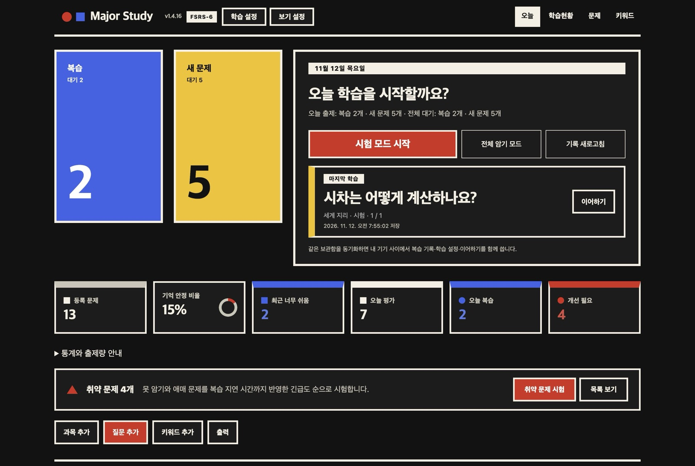
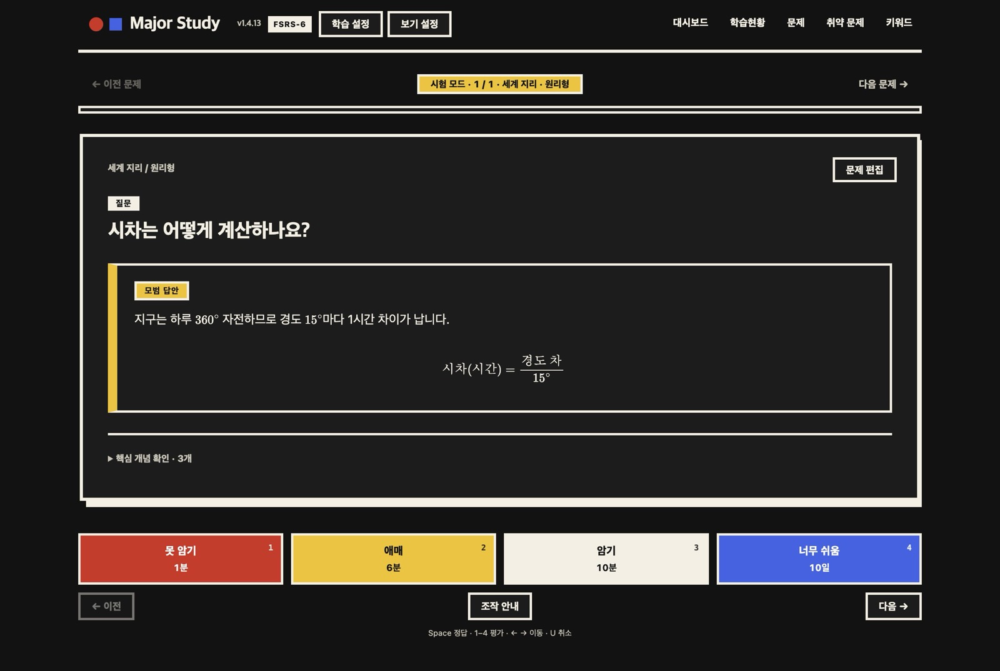
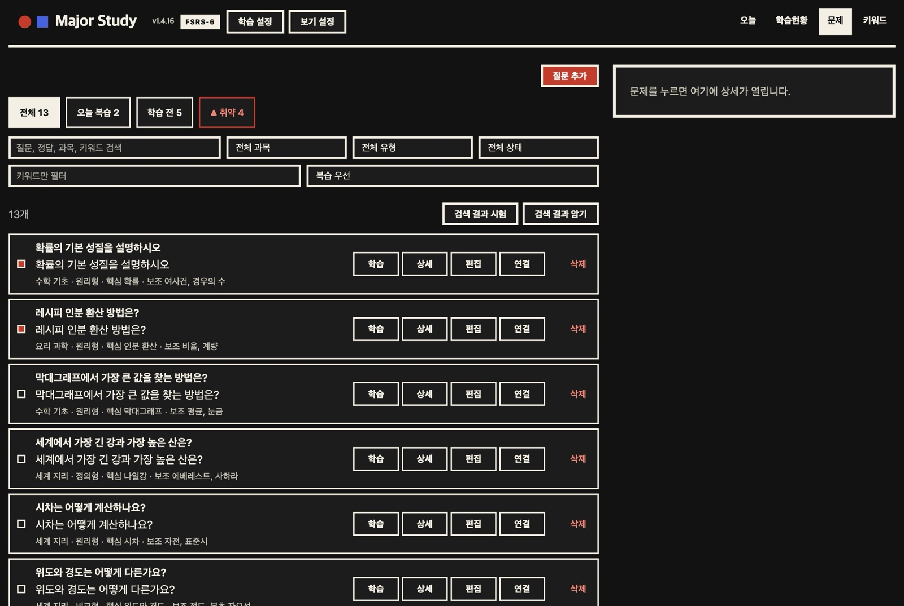
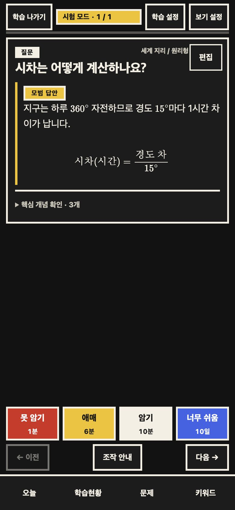

<div align="center">

# MIA Study for Obsidian

**전공 질문을 모으고, 키워드로 연결하고, FSRS-6로 잊기 전에 다시 복습하는 Obsidian 플러그인**

[](https://github.com/kimchi-kang/mia-study-obsidian/releases/latest)
[](https://github.com/kimchi-kang/mia-study-obsidian/releases)


[](LICENSE)

[**소개 페이지**](https://kimchi-kang.github.io/mia-study-obsidian/) · [**1.4.17 다운로드**](https://github.com/kimchi-kang/mia-study-obsidian/releases/download/1.4.17/mia-study-1.4.17.zip) · [변경 내역](docs/releases/1.4.17.md) · [현재 상태](STATUS.md)



</div>

1.4.13부터 플러그인 화면이 소개 페이지와 같은 바우하우스 스타일(원색, 두꺼운 테두리, 각진 모서리, 4색 평가 버튼)로 바뀌었습니다. 동작과 저장 형식은 그대로입니다.

Obsidian 안에서 과목·질문·키워드를 폼으로 관리하면서 FSRS-6 복습, 핵심·보조 키워드, 키워드 의미 노트, 연관 문제 추천을 제공한다. Markdown을 직접 작성할 필요가 없고 문제 하나마다 노트를 만들지도 않는다.

| 학습 화면 | 문제 목록 | 모바일 |
|---|---|---|
|  |  |  |

화면은 1.4.13 바우하우스 디자인(빨강·노랑·파랑, 두꺼운 테두리, 각진 모서리)과 직접 만든 일반 상식 데모 보관함(수학 기초·세계 지리·요리 과학)으로 찍었습니다. 수식·이미지·표·코드 렌더링을 보여 주는 예시 질문이며 실제 학습 내용이 아닙니다. 모바일 화면은 데스크톱 Obsidian에서 휴대폰 폭을 흉내 낸 것입니다.

[1.4.17 정식 릴리스](https://github.com/kimchi-kang/mia-study-obsidian/releases/tag/1.4.17) · [다운로드·설치 안내](https://kimchi-kang.github.io/mia-study-obsidian/) · [현재 상태](STATUS.md) · [1.4.17 변경 내역](docs/releases/1.4.17.md) · [이전 버전 이력](docs/releases/HISTORY.md)

Major Study 제목 바로 옆에서 현재 실행 중인 버전을 확인할 수 있습니다. 업데이트한 파일을 로드하려면 Obsidian을 다시 시작하세요. 수식은 원문에 `$...$` 또는 `$$...$$` 구분자와 TeX 문법이 있어야 표시됩니다. 예를 들어 `vC(t) = Vs(1 - e^(-t/RC))` 같은 일반 문장은 자동으로 수식으로 바뀌지 않습니다.

## 설치

아직 Obsidian 커뮤니티 디렉터리에 등록되지 않은 플러그인이므로 BRAT으로 설치한다.

1. Obsidian 커뮤니티 플러그인에서 `BRAT`을 설치하고 활성화한다.
2. 명령 팔레트에서 `BRAT: Add a beta plugin for testing`을 실행한다.
3. `https://github.com/kimchi-kang/mia-study-obsidian`을 입력한다.
4. 설치 후 커뮤니티 플러그인 목록에서 `MIA Study`를 활성화한다.

데스크톱과 모바일을 모두 지원한다.

업데이트·복구·모바일 직접 설치는 [INSTALL.md](INSTALL.md)를 따른다.

## 사용

1. Obsidian을 다시 로드한 뒤 리본의 뇌 아이콘을 누르거나 명령 팔레트에서 `MIA Study 열기`를 실행한다.
2. 첫 화면에서 `과목 추가`를 누른다. 과목 폴더와 문제은행 노트가 자동 생성된다.
3. `질문 추가`에서 과목, 질문, 정답, 유형, 핵심·보조 키워드와 각 의미를 입력한다. 꼬리질문은 과목·제목·질문 내용으로 검색해 최대 50개까지 선택할 수 있다.
4. `학습현황`에서 전체·학습 전·기억 안정·오늘 평가·오늘 복습·최근 평가와 과목별 상태를 확인한다. 숫자를 누르면 해당 문제만 모아 볼 수 있다.
5. 문제 화면에서 질문의 상세 정보·복습 기록을 보거나 질문을 편집·삭제한다. 과목을 바꾸어 저장하면 기존/새 과목의 문제은행과 과목 노트가 함께 갱신된다.
6. `오늘` 화면의 과목 카드에서 과목 이름을 수정하거나 과목을 삭제하고, 키워드 화면에서 키워드의 이름·의미를 수정하거나 삭제한다.
7. `오늘` 화면의 `시험 모드 시작`은 정답을 가리고, `전체 암기 모드`는 정답을 처음부터 표시한다. 시험은 상세 학습관리의 상한과 순서를 따르고, 랜덤 암기는 복습 기한이 된 문제를 먼저, 새 문제를 다음에 내며 각 그룹 안에서 무작위로 배치한다. 암기는 MIA 플러그인 설정 또는 `보기 설정`의 `암기 모드 순서`에서 `순서대로` / `랜덤`을 선택한다(기본 랜덤, 기기별 저장). `순서대로`는 현재 문제 목록 순서를 따른다. 아직 복습 기한이 안 된 문제는 제외하며 변경한 설정은 새 학습부터 적용한다.
8. 정답을 본 뒤 `못 암기`, `애매`, `암기`, `너무 쉬움` 중 하나를 고른다. `애매`는 정답을 기억했지만 어려웠다는 뜻이다. 떠올리지 못했다면 `못 암기`를 고른다. 시험 모드의 일일 상한은 상세 학습관리에서 조정한다.
9. 학습·재학습 중인 문제는 예정 시각이 되면 같은 세션에서 다시 출제된다. 다른 문제가 없으면 다음 복습 시각까지 대기하고 자동으로 재개한다. 다음날 이후의 정규 복습은 Anki처럼 **기한일 단위**로 출제한다. 하루 시작 시각(기본 04:00)부터 그날이 기한인 복습은 예약 시각 전이라도 출제하므로, 매일 비슷한 시간에 공부해도 복습이 하루씩 밀리지 않는다. 1분·10분 같은 학습 단계와 하루 미만의 고정 간격은 정확한 시각을 따른다.
10. 화면 왼쪽 가장자리에서 중앙 방향으로 쓸면 학습을 시작한 화면으로 돌아간다. 이어하기로 같은 위치를 복원할 수 있다. 제스처로 문제를 넘기지 않으며 이전·다음 버튼을 사용한다. `보기 설정`에서 뒤로가기 제스처와 민감도를 조정할 수 있다.
11. 이전 문제로 돌아가 같은 출제를 다시 평가하면 해당 평가를 대체한다. 예정 시각에 다시 출제된 문제는 현재 FSRS 상태에서 새 평가를 누적한다. `직전 평가 취소`는 그 평가 직전의 상태와 학습 순서를 복구한다.

일정 계산은 기존 [TS-FSRS](https://github.com/open-spaced-repetition/ts-fsrs) 구현을 사용한다. 날짜 분산과 평가 의미는 [Anki 학습 설명](https://docs.ankiweb.net/manual/studying), 망각 가능성에 따른 정렬은 [Anki 덱 옵션](https://docs.ankiweb.net/manual/deck-options)을 참고했다. 개인별 FSRS 가중치 최적화는 포함하지 않는다.

추가 기능:

- 취약 문제: `오늘` 화면의 취약 문제 띠(`취약 문제 시험` / `목록 보기`)와 `문제` 탭의 `▲ 취약` 필터에서 못 암기·애매 문제를 복습 지연 시간이 포함된 긴급도 순으로 보고 바로 시험한다.
- `연결`: 질문을 검색·과목 필터로 최대 50개까지 선택하며 단방향 또는 양방향으로 연결한다.
- 자동 추천: 키워드·과목·질문 유형·최근 평가를 바탕으로 5점 이상인 관련 질문을 현재 시험에 추가한다.
- 질문 목록: 생성·수정일, 취약도, 애매 우선 정렬과 필터 칩, 한글 조합 검색, 50개 단위 페이지를 지원한다.
- 시험 결과: 평가별 개수·건너뜀·소요 시간을 보여주고 같은 범위 재시작 또는 시작 화면 복귀를 제공한다.

화면 이동 기록은 Obsidian 자체 탐색 기록에 저장된다. 모바일 하단바와 데스크톱 상단바의 `←/→` 화살표로 이전·다음 MIA 화면을 오갈 수 있다.

- 모바일 입력: 키보드가 열리면 과목·질문·키워드 편집창과 검색·설정 화면이 키보드 위 높이에 맞춰지고, 선택한 입력칸이 자동으로 보이도록 스크롤된다.
- 모바일 UI: 상단 메뉴는 한 줄 탭으로 축약되고, 문제 검색 필터는 접을 수 있다. 통계·질문·시험·키워드 화면은 44px 이상 터치 영역과 2열/1열 반응형 카드, 하단 안전영역을 사용한다.

기본 저장 위치는 다음과 같다.

- 과목: `MIA/<과목>/`
- 여러 질문: `MIA/<과목>/문제은행.md`
- 간단 질문·대답 목록: `MIA/<과목>/<과목> 노트.md`
- 키워드 의미: `MIA/키워드/<키워드>.md`

과목 노트는 질문을 추가·수정·이동·삭제할 때마다 아래처럼 자동으로 다시 동기화된다. 플러그인을 시작할 때도 모든 과목을 다시 검사하며, 명령 팔레트의 `MIA Study: 과목 노트 다시 동기화`로 수동 복구할 수 있다.

```markdown
질문: 가우스 법칙은 무엇인가?
대답: 폐곡면을 지나는 전기 선속과 내부 전하를 연결하는 법칙이다.
```

질문과 대답에 줄바꿈이 있더라도 과목 노트에서는 각각 한 줄로 정리된다. 같은 이름의 사용자 노트가 이미 있으면 이를 덮어쓰지 않고 저장을 중단한다. 질문을 수정하거나 다른 과목으로 옮겨도 문제 ID를 유지하므로 기존 FSRS 복습 기록은 사라지지 않는다. 질문 삭제 시 문제은행·과목 노트·FSRS 기록이 함께 정리된다. 과목 삭제는 폴더를 Obsidian 휴지통으로 이동한다. 키워드 이름을 바꾸거나 삭제하면 연결된 모든 문제은행의 핵심·보조 키워드 정보도 함께 갱신된다.

## 학습 설정

MIA 첫 화면의 `학습 설정` 또는 Obsidian 설정 → MIA Study에서 하루 학습량, 학습·재학습 단계, 목표 기억률, 출제 순서, FSRS 가중치를 바꾼다. 변경은 `학습 설정 저장`을 눌러야 적용된다. 기본값은 새 문제 20개/일, 복습 200회/일, 하루 시작 오전 4시, 학습 `1m 10m`, 재학습 `10m`, 목표 기억률 90%다.

- Anki 설정과의 대응·차이: [docs/ANKI-SETTINGS.md](docs/ANKI-SETTINGS.md)
- 학습 단계·일정 정책: [docs/SCHEDULER-POLICIES.md](docs/SCHEDULER-POLICIES.md)

## 과목별 질문·답변 Word 정리본 출력

MIA `오늘` 화면의 **출력**을 누르면 과목 선택창이 열린다. 과목을 클릭하면 해당 과목의 등록된 모든 질문과 답변을 원본 파일·문제 순서대로 정리한 **Word(.docx)** 파일을 PC에서는 운영체제의 **다운로드 폴더**에 저장한다. 모바일에서는 보관함의 `MIA 출력/` 폴더에 저장한다. 질문 목록의 검색·복습 필터와 관계없이 선택한 과목 전체를 출력한다. 명령 팔레트의 `MIA Study: 과목 질문 답변 Word로 출력`으로도 실행할 수 있다.

- 과목 제목 아래 `질문 1 → 답변 → 질문 2 → 답변` 순서로 정리한다. 중복된 문제 제목, 문제 ID, 학습 정보, 별도 `원문:` 출처 링크는 넣지 않는다.
- A4 여백과 흑백 글자 스타일을 적용한다. 글자 강조·목록·표·코드와 보관함 안의 PNG·JPG·GIF·BMP 이미지를 포함한다. 일반 링크는 표시 문구만 남긴다.
- 수식은 Word 수식 객체로 변환하지 않고 원문 LaTeX 표기로 보존한다. 외부 이미지 주소는 다운로드하지 않으며, 지원하지 않거나 찾지 못한 이미지는 위치를 텍스트로 표시하고 완료 화면에 안내한다. 잘못된 이미지 파일을 읽다가 실패하면 성공으로 표시하지 않는다.
- 완료 화면에 실제 저장 경로가 표시된다. `파일 열기`로 Word 등 연결된 앱에서 확인하고 인쇄하며, PC에서는 `저장 폴더에서 보기`로 파일 위치를 바로 연다. 실행할 때마다 날짜·시각이 붙은 새 파일을 만들므로 기존 출력 파일을 덮어쓰지 않는다.
- 원본 문제은행·과목 노트·복습 기록은 수정하지 않는다. 출력 파일에는 자신의 학습 내용이 들어가므로 개인 보관함에서 관리한다. 플러그인에서 서버로 자료를 전송하지 않는다.

PC에서는 보관함 밖의 다운로드 폴더에 저장하므로 보관함 동기화 대상에 자동으로 포함되지 않는다. 모바일은 보관함 안에 저장한다. 실제 페이지 배치는 설치된 글꼴과 Word 등 문서를 여는 앱에 따라 달라질 수 있다.

## GPT·에이전트로 문제를 한 번에 가져오기

문제 자료와 [사용자 에이전트 가이드 MIA-AGENT.md](MIA-AGENT.md)를 GPT나 파일을 편집할 수 있는 에이전트에 함께 전달하면, MIA 형식으로 문제를 정리할 수 있다. 가이드에는 여러 문제 가져오기, 중복 확인, 기존 답안 수정, 과목 이동, 키워드·이어보기 연결과 복습 기록 보존 규칙이 담겨 있다.

> 첨부한 자료를 MIA-AGENT.md에 따라 수학 과목으로 정리해줘. 원문 정답을 보존하고 중복은 건너뛰어줘. 답이 없거나 판독이 불확실한 항목은 따로 알려줘. 보관함에 접근할 수 있으면 적용하고, 없으면 내려받을 문제은행 Markdown과 저장 위치를 알려줘.

파일 접근이 없는 GPT는 변환한 파일을 제공하므로 직접 보관함에 넣어야 한다. 기존 문제은행을 덮어쓰지 말고 새 파일 이름으로 저장한다. 기존 내용을 수정하려면 해당 파일도 제공해야 한다. 파일을 편집할 수 있는 에이전트는 허용된 보관함에 직접 반영할 수 있다. 외부 편집 후에는 명령 팔레트의 `MIA Study: 과목 노트 다시 동기화`를 실행한다. 개인 자료는 본인의 보관함에만 저장하며 이 공개 저장소에 업로드하지 않는다.

## PC·폰 동기화: Obsidian Sync 구독 없이 사용하기

[Obsidian Sync](https://obsidian.md/sync)는 유료 선택 서비스다. [Obsidian 공식 안내](https://obsidian.md/help/sync-notes)처럼 외부 클라우드나 동기화 도구로 보관함을 공유하는 방법도 사용할 수 있다. MIA의 문제는 Markdown 파일이므로, 같은 보관함을 동기화하면 PC에서 입력한 문제를 폰에서도 열고 학습할 수 있다. 보관함은 각 기기의 로컬 폴더에 두며, 클라우드·NAS는 기기 사이에서 파일을 전달하는 역할을 한다.

무료 저장 공간이나 이미 보유한 NAS를 활용하면 Obsidian Sync 구독료 없이 구성할 수 있다. 클라우드 용량·서버 운영·외부 도구의 유료 기능 비용은 별도로 확인한다. MIA 자체가 클라우드 연결이나 파일 전송 기능을 제공하는 것은 아니다.

### 기기에 맞는 방법 선택

| 사용 환경 | 동기화 방법 |
| --- | --- |
| Mac + iPhone·iPad | iCloud Drive의 Obsidian 보관함을 함께 사용한다. |
| Windows·Mac + Android | 클라우드 폴더와 Android용 폴더 동기화 앱을 연결하거나, 아래 동기화 플러그인 방식을 사용한다. |
| PC + iPhone·Android + 사설 클라우드·NAS | 각 기기의 Obsidian에 [Remotely Save](https://github.com/remotely-save/remotely-save)를 설치하고, NAS·Nextcloud 등의 WebDAV 저장 공간을 같은 동기화 대상으로 지정한다. |

iPhone·iPad에서는 Google Drive·OneDrive의 폴더를 데스크톱처럼 바로 보관함으로 여는 방식이 공식 지원되지 않는다. iCloud 또는 모바일을 지원하는 동기화 플러그인을 사용한다. Windows용 iCloud는 파일 중복·손상 문제가 있을 수 있어 Apple 기기 간 iCloud 사용과 구분해야 한다.

### 사설 클라우드·NAS로 연결하는 예시

1. NAS·Nextcloud 등에 기기들이 접근할 수 있는 WebDAV 저장 공간을 준비한다.
2. PC와 폰의 Obsidian에 같은 이름의 로컬 보관함을 만들고, 각 기기에 같은 최신 버전의 MIA Study와 Remotely Save를 설치·활성화한다.
3. Remotely Save에서 WebDAV를 선택하고, 같은 서버 주소·계정·원격 보관함 경로를 연결한다. 암호화를 사용한다면 기기마다 같은 암호를 설정한다.
4. PC에서 MIA로 문제를 입력하고 동기화를 끝낸 뒤, 폰에서 동기화해 문제를 내려받고 MIA를 연다. 이미 자료가 있는 보관함은 먼저 백업하고, 첫 동기화 방향을 확인한다.

문제·첨부 파일과 학습 상태의 동기화 대상을 함께 확인한다.

| 함께 사용할 정보 | 동기화할 파일 |
| --- | --- |
| 문제·답안·키워드 노트 | 기본 `MIA/` 폴더와 이미지 등 첨부 파일. 저장 위치를 변경했다면 해당 폴더도 포함한다. |
| 복습 기록·MIA 설정 | `.obsidian/plugins/mia-study/data.json` |
| 마지막 학습의 이어하기 위치 | `.obsidian/plugins/mia-study/ui-state.json` |
| 범용 모드의 학습 기록·설정·이어하기 | `MIA Study Sync/` 폴더의 Markdown 파일 3개 전체 |

범용 모드를 사용하면 숨김 설정 폴더 대신 `MIA Study Sync/` 폴더를 일반 노트와 함께 동기화한다. 기존 저장 방식을 계속 쓰는 경우 Remotely Save는 기본적으로 `.obsidian` 설정 폴더를 동기화하지 않는다. 기존 경로의 복습 기록과 이어하기도 공유하려면 설정 폴더 동기화 옵션을 확인하고, 위 두 파일이 실제로 전송되는지 확인한다. 해당 옵션은 Remotely Save에서 실험 기능으로 안내하므로, 문제 노트가 보인다는 이유만으로 학습 상태도 전달됐다고 가정하지 않는다. 글자 크기·답안 배치 같은 MIA 보기 설정은 기기별 로컬 설정으로 유지된다.

같은 보관함에는 동기화 방식을 하나만 사용한다. 한 기기에서 학습을 마치고 동기화 완료를 확인한 다음 다른 기기에서 최신 내용을 받으면 충돌을 줄일 수 있다. Remotely Save의 자동 동기화는 Obsidian이 실행 중일 때 동작하므로, 특히 폰에서는 앱을 닫기 전에 전송이 끝났는지 확인한다. 개인 문제와 학습 기록은 자신의 비공개 저장 공간에 보관한다.

이 안내는 동기화 구성 예시이며, 모든 NAS·모바일·동기화 도구 조합을 MIA 실기기로 검증한 것은 아니다. 연결·설정 폴더 동기화·충돌 처리의 세부 사항은 [Remotely Save 문서](https://github.com/remotely-save/remotely-save#readme)와 [Obsidian 동기화 안내](https://obsidian.md/help/sync-notes)를 확인한다.

### 범용 동기화 폴더

`학습 설정` 창 아래의 `내 기기 간 동기화 → 범용 동기화 폴더 사용`을 선택하면, 학습 기록과 이어하기를 일반 보관함의 `MIA Study Sync/` 폴더에 Markdown 파일로 저장한다. 숨김 `.obsidian` 폴더를 전송하지 않는 동기화 도구에서도 일반 노트와 함께 전달할 수 있게 하기 위한 선택 모드다. 기존 iCloud 사용 방식은 기본으로 유지되며 자동 전환하지 않는다.

1. 모든 기기에 같은 최신 MIA를 설치한다.
2. 한 기기에서 `범용 동기화 폴더 사용`을 선택한다. 기존 복습 기록과 이어하기를 복사·병합하고 원래 파일은 보존한다. 이 기기에서는 바로 새 저장 위치를 사용한다.
3. 문제 노트와 `MIA Study Sync/` 폴더 전체를 같은 동기화 대상으로 전달한다.
4. 다른 기기에서 파일 수신이 끝난 뒤 MIA를 다시 시작한다. 공유 폴더를 자동으로 인식한다.

기록·학습 설정·이어하기는 공유하고 보기 설정은 기기별로 유지한다. 이 폴더의 파일은 자동 관리하므로 직접 편집하지 않는다. 이전 플러그인은 새 저장 위치를 알지 못하므로 함께 사용하는 모든 기기를 업데이트한다. 계정 연결·클라우드 전송을 MIA가 대신 수행하는 기능은 아니다. Windows·Android에서도 [Obsidian Sync](https://obsidian.md/help/sync-notes) 또는 [Remotely Save](https://github.com/remotely-save/remotely-save) 등으로 동일한 보관함을 동기화해야 한다. 한 보관함에는 전송 도구 하나를 사용한다.

## 저장 형식

하나의 노트에 아래 블록을 여러 개 둘 수 있다.

```markdown
### 예제 1 - 가우스 법칙

> [!question] 문제
> 구대칭 전하분포의 전기장을 구하여라.

#### 풀이

가우스 법칙을 적용하면 ...
```

MIA에 등록하면 플러그인이 질문과 풀이를 바꾸지 않고 문제 블록 ID와 접힌 학습 정보만 추가한다.

```markdown
^mia-q-...

> [!mia]- 학습 정보
> 유형: 계산형
> 핵심: [[MIA/키워드/가우스 법칙|가우스 법칙]]
> 보조: [[MIA/키워드/구대칭|구대칭]]
> 생성: 2026-08-16T00:00:00.000Z
> 수정: 2026-08-16T00:00:00.000Z
```

기존 Markdown 문제도 계속 지원한다. `문제` 화면의 `등록하지 않은 문제 후보`에서 등록하거나, 노트 편집 화면에서 `커서의 문제를 MIA에 등록/편집` 명령을 사용할 수 있다.

## 데이터

- 질문·풀이·키워드 연결: 원본 Markdown 노트
- FSRS 복습 기록: `.obsidian/plugins/mia-study/data.json`
- 키워드 의미: 기본값 `MIA/키워드/*.md`

등록 전에는 원본 노트를 수정하지 않는다. 등록할 때도 `Vault.process`를 사용해 최신 원문에서 문제를 다시 찾으며, 안전하게 식별하지 못하면 쓰기를 중단한다.

### 여러 기기의 기록 보호

설정은 변경 계보와 보관 사본으로 보호한다. 편집 시작값을 아는 서로 다른 항목은 함께 적용하고, 같은 항목 충돌이나 기준을 모르는 오프라인 분기는 시작 화면의 ‘보관된 설정 확인’에서 비교·선택한다. 저장 완료가 불확실하면 ‘미완료 저장 확인’에서 원본을 보관하고 재시도한다. 이때 평가를 다시 계산하거나 서로 다른 평가 이력을 합산하지 않는다. 자세한 범위는 [다기기 유실 검증](docs/qa/archive/MULTI-DEVICE-SYNC-QA.md), 실제 두 기기에서 확인할 내용은 [점검표](docs/qa/archive/MOBILE-SYNC-CHECK.md)를 따른다.

기기 내 복구 사본은 각 기기의 Obsidian 로컬 저장소에 남는다. 모든 기기에서 같은 최신 플러그인을 사용해야 수정 번호와 취소 표시가 유지된다. 파일 기반 iCloud 동기화의 전송 시점·충돌 파일 생성까지 통제하거나 동시 쓰기의 원자성을 보장하지는 않는다. 실제 iOS 키보드·앱 강제 종료·VoiceOver·기기 간 iCloud 전송 검증은 실기기가 필요하다.

## 플러그인 시작과 안전한 업데이트

0.10.2부터 Word 출력 라이브러리는 실제 출력 때만 불러온다. MIA 시작 시 모바일에서 사용할 수 없는 Node·Electron 모듈을 요청하지 않는지 배포 번들로 검사한다. 시작 중 오류가 나더라도 정리 과정이 추가 오류를 내지 않도록 처리한다.

명령 팔레트의 `MIA Study: 시작 상태 확인`에서 현재 버전과 이 기기에 남은 시작 실패 기록을 확인할 수 있다. 진단 기록은 기기 로컬 저장소에만 최근 20건을 보관하며 질문·답안·파일 경로·오류 메시지를 포함하지 않는다. 과거 기록이 없던 시점의 비활성화 원인이나 설정을 바꾼 기기를 이 기록으로 소급해 알 수는 없다.

개발 중 기본 `.obsidian` 설정 폴더를 사용하는 보관함의 설치 파일을 갱신할 때는 다음 절차를 따른다.

```sh
npm run build
npm test
npm run install:local -- --vault "/absolute/path/to/vault"
```

`THIRD-PARTY-NOTICES.txt`의 외부 코드 저작권·라이선스 고지는 빌드 때 `main.js` 주석에 포함되므로 세 배포 파일만 설치해도 함께 전달된다. 의존성이나 사전 번들 라이브러리를 변경할 때는 내부 코드의 릴리스 출처와 고지문도 다시 확인한다. 플러그인 자체 코드는 [MIT 라이선스](LICENSE)이며, MIT 전문도 `main.js`에 포함된다. 외부 코드에는 각 원저작자의 고지가 별도로 적용된다.

이 설치 명령은 완성된 `main.js`·`styles.css`·`manifest.json`을 임시 파일로 쓴 뒤 교체한다. `.obsidian/community-plugins.json`의 활성화 목록과 `data.json`·`ui-state.json`은 수정하지 않는다. 설치 후 Obsidian을 다시 시작해 새 파일을 불러온다. 여러 기기가 설정 폴더를 공유할 때 업데이트 목적으로 MIA 스위치를 껐다 켜면, 꺼진 상태까지 동기화될 수 있으므로 해당 방식은 피한다.

`--vault`에는 이미 존재하는 보관함 폴더를 지정한다. 명시적으로 선택한 보관함 자체의 별칭은 사용할 수 있지만, `.obsidian`·`plugins`·`mia-study`가 보관함 밖으로 연결되면 설치를 중단한다. 기본 `.obsidian`만 지원하며 사용자 지정 설정 폴더에는 이 명령을 사용하지 않는다.

파일을 교체하기 전에 해당 보관함의 Obsidian을 닫는다. 서로 다른 빌드를 같은 보관함에 동시에 설치하지 않는다. 설치 완료 전 세 파일 전체를 원본과 대조하며, 대조한 파일 내용이 원본과 다르면 검증 오류를 표시한다. 이 순차 읽기 검사는 검사 중 또는 끝난 뒤 다른 설치나 클라우드가 다시 덮어쓰는 것까지 막는 잠금은 아니다. 세 배포 파일 전체를 한 번에 교체하는 트랜잭션은 아니므로 설치 오류·강제 종료가 있었다면 앱을 열기 전에 같은 빌드로 설치를 다시 실행한다. 이전 배포 파일로 되돌려야 한다면 `main.js`·`styles.css`·`manifest.json`만 복원하고, 학습 자료·`data.json`·`ui-state.json`을 과거 사본으로 함께 덮어쓰지 않는다. 구버전 앱에서 현재 학습 데이터가 호환된다는 보장은 별도 검증이 필요하다. 강제 종료 시 숨김 임시 파일이 남을 수 있으며, 재설치가 이를 모두 정리하는 것은 아니다.


“플러그인이 더 이상 활성화되지 않음”은 기존 탭의 플러그인이 로드되지 않았다는 뜻이다. 플러그인 파일 부재·비활성화·시작 오류를 구분해야 하며, 이 화면만으로 데이터 삭제나 특정 오류를 단정할 수 없다. 공유 설정의 다른 기기나 외부 도구가 플러그인을 끄는 동작을 MIA가 임의로 되돌리지는 않는다.

## 개발 및 검증

```bash
npm install
npm test
npm run build
```

필수 감사까지 포함한 재현 가능한 전체 검사는 다음 명령을 사용한다. `npm ci`는 잠금 파일의 개발 의존성까지 설치한다. Node.js는 의존성이 요구하는 버전(권장 22.12 이상 지원 LTS)을 사용한다.

```bash
npm ci
npm run verify:full
```

`verify:full`은 저장소의 `tests/fixtures/vault`를 새 임시 보관함으로 복사하고 `MIA_AUDIT_VAULT`를 그 경로로 강제 지정한다. 외부에서 지정한 사용자 보관함이나 `NODE_PATH`에 의존하지 않는다. 전체 테스트 후 두 필수 감사가 실제 통과했는지와 실패·건너뜀 0을 확인하고, 기존 `build` 명령의 타입 검사와 프로덕션 빌드를 실행한다. 준비 실패·누락된 감사·건너뜀·빌드 실패는 명령 실패로 처리한다. 결과 JSON은 매번 별도 `artifacts/verification/run-*/`에 남기고 임시 보관함은 정리한다. 테스트 필터 인수는 받지 않는다.

실제 보관함 호환성 감사는 해당 보관함을 읽기만 한다.

```bash
MIA_AUDIT_VAULT="/path/to/vault" npx vitest run tests/vault-audit.test.ts
```

`MIA_AUDIT_VAULT`를 지정하지 않으면 외부 보관함을 임의로 선택하지 않도록 호환성 감사 2개가 건너뛰어진다. 두 검사는 질문의 빈 본문·답안·파서 진단과 메모리 안의 메타데이터 왕복 보존을 확인한다. 저장소의 합성 보관함으로 이 검사까지 실행하려면 프로젝트 루트에서 다음과 같이 실행한다. 실제 사용자 보관함 호환성 검증 결과로 해석하지 않는다.

```bash
MIA_AUDIT_VAULT=tests/fixtures/vault npm test
```

더미 문제를 포함한 기능·안전성 검사 항목과 수동 QA 순서는 [`SAFETY-QA.md`](docs/SAFETY-QA.md)에 정리되어 있다.

버전별 변경 내역은 [docs/releases/](docs/releases/), 버전별 검증 기록은 [docs/qa/](docs/qa/)에 있다. 1.4.0 이전의 기능 설명은 [이전 버전 이력](docs/releases/HISTORY.md), 과거 QA·감사 문서는 [docs/qa/archive/](docs/qa/archive/)에 보존한다.

## 라이선스와 복습 알고리즘 출처

MIA Study 자체 코드는 [MIT](LICENSE)로 배포한다. 외부 코드의 저작권·라이선스는 [THIRD-PARTY-NOTICES.txt](THIRD-PARTY-NOTICES.txt)에 보존한다.

복습 일정은 **Anki에서도 지원하는 FSRS 계열의 FSRS-6 알고리즘**을 사용한다. 실제 구현은 Open Spaced Repetition의 [ts-fsrs 5.4.1](https://github.com/open-spaced-repetition/ts-fsrs)(MIT)이다. [Anki의 FSRS 안내](https://docs.ankiweb.net/manual/deck-options#fsrs)와 [FSRS-6 알고리즘 설명](https://github.com/open-spaced-repetition/fsrs4anki/wiki/The-Algorithm#fsrs-6)을 참고할 수 있다. 이는 Anki 소스 코드를 복사했다는 의미나 Anki와 일정이 완전히 같다는 보장이 아니다. 개인별 FSRS 가중치 최적화는 포함하지 않는다.
