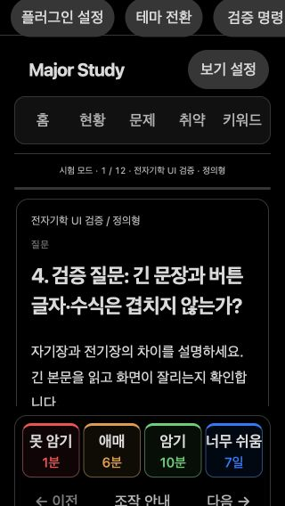
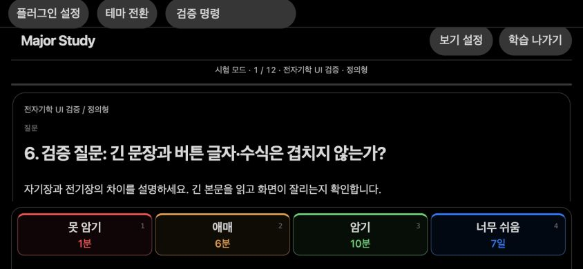
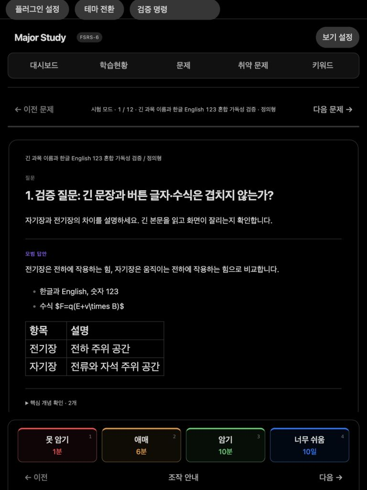

# MIA Study 0.10.6 — 최종 검증 / 2026-10-25

- 전체 자동 검사: 1,003개 통과, 조건부 2개는 별도 1,000문제 더미 보관함에서 30초 제한으로 실행해 통과. 서로 다른 검사 총 1,005개가 두 실행에서 통과했다.
- 모바일 관련 59개 자동 검사는 위 전체 검사의 일부이며 별도로 합산하지 않는다.
- 실제 Mac Obsidian 1.14.5: 24개 항목 통과. 별도 더미 보관함에서 삭제 범위·키워드 편집·문제 이동·상대경로 이미지 로드·평가/취소·화면 재로딩 후 기록/이어하기를 확인했다. 동시 수정은 실제 Vault API에 쓰기 시점을 제어해 주입했다.
- 모바일 모의환경: 6가지 화면, 네 평가 버튼 저장·취소 24쌍, 추가 16개 확인 통과. 브라우저 런타임 오류 0개.
- 타입 검사·배포 빌드 통과. 재빌드한 실행 파일은 기존 0.10.6 배포본과 바이트 단위로 같다.

## 실행 범위와 제약

모바일은 인앱 브라우저, 추출된 Obsidian CSS와 대체 파일·설정·Markdown API를 사용하는 모의환경이다. 실제 휴대폰의 Obsidian, iOS/Android WebView, 실제 IME·소프트키보드·safe-area·클라우드 동기화를 검증한 결과가 아니다. 터치는 합성 PointerEvent이며 키보드는 가용 화면 높이 축소로 근사했다.

모의 키보드 전환 직후 호스트의 클릭 위치가 스크롤과 어긋나는 사례가 있어 호스트 설정창은 키보드 활성화로 닫았다. 이를 실기기 제품 결함으로 확정하지 않았다. 실제 키보드 조작의 추가 확인 항목이다. 수식은 대체 Markdown 렌더러의 원문 표시여서 실제 Obsidian의 수식 품질 검증에 해당하지 않는다.

Mac의 Force Reload는 앱 프로세스를 완전히 종료하고 다시 시작하는 검사와 구분한다. 테스트 후 컴퓨터 제어 연결 실패로 원래 창 복귀는 확인하지 못했으며, 개인 자료·복습·이어하기 보존은 별도 해시 비교로 확인했다. 개인 자료·설정·백업·개인 화면은 이 공개 자료에 포함하지 않았다.

1,000문제를 한 파일에 넣고 모든 문제의 메타데이터 왕복 변환을 반복한 추가 검사에서는 초기 실행이 약 6.3초로 기본 5초 제한을 넘었다. 검사에만 30초 제한을 적용해 다시 실행했다. 대용량 처리 지연 제약을 해소했다는 의미가 아니다.

## 화면

| 화면 조건 | 크기 | 평가·취소 | 겹침·가로 넘침 |
|---|---|---|---|
| 작은 휴대폰·큰 글자 | 320×568 | 4쌍 통과 | 없음 |
| 휴대폰·밝은 테마 | 360×780 | 4쌍 통과 | 없음 |
| 휴대폰 | 390×844 | 4쌍 통과 | 없음 |
| 큰 휴대폰·큰 글자 | 430×932 | 4쌍 통과 | 없음 |
| 가로 화면·큰 글자 | 844×390 | 4쌍 통과 | 없음·본문 스크롤 필요 |
| 태블릿·큰 글자 | 768×1024 | 4쌍 통과 | 없음 |

[구조화한 검증 결과](verification.json)

