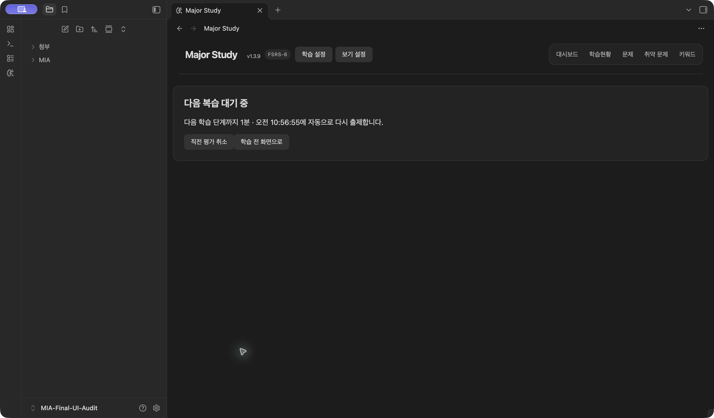
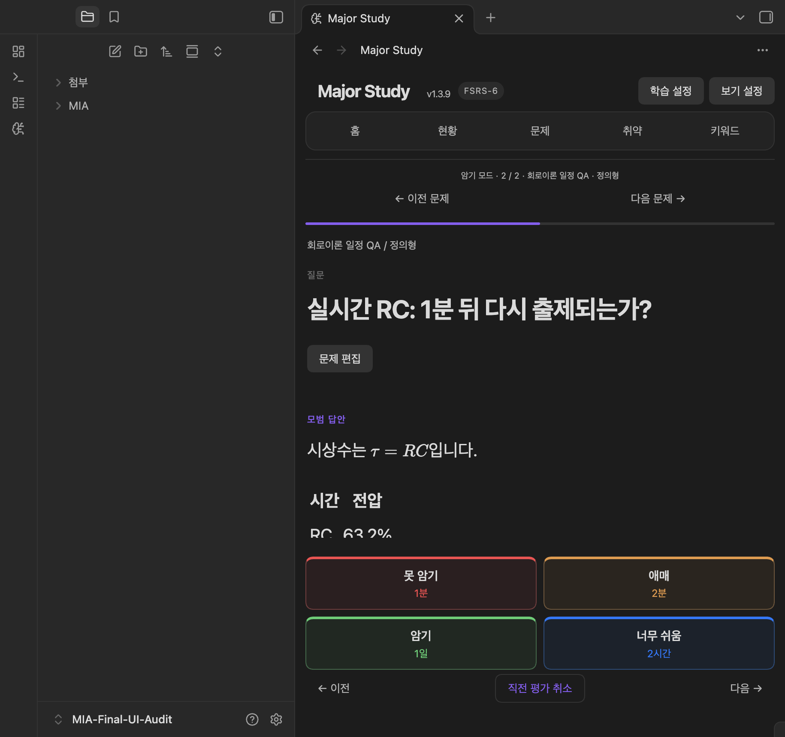

# 2026-11-06 학습 일정·출제 경계 감사 — 로컬 1.3.10 후보

**부분 완료. 제품 결함 5건은 수정하고 자동 재검증했지만, 1.3.10 실제 Obsidian 재검증은 미완료입니다.** 이번에 실제로 로드하고 조작한 빌드는 1.3.9입니다. 과거 실제 앱 통과를 새 후보의 통과로 옮기지 않습니다.

## 대상과 보존

- 시작 소스: 1.3.9, `1ea7ae9`, 미커밋 변경 없음. 직전 제품 수정은 `a153bc3`의 평가 복구 집계 보존입니다.
- 수정 후보: **1.3.10**, package·lockfile·manifest·versions 일치. 저장 스키마·FSRS 버전·동기화 병합 정책은 유지합니다. 일정 상한과 학습일 경계의 버그는 수정합니다.
- 실제 환경: macOS **27.2 (26B123)**, 실제 Obsidian **1.15.0**. 기존 `MIA-Final-UI-Audit`만 사용하고 새 보관함·앱·프로필·진단 플러그인은 만들지 않았습니다.
- 테스트 보관함 디스크는 최종 빌드 1.3.10과 세 파일 일치. **마지막 관찰 실행 버전은 1.3.9**, 새 파일의 정상 재로드는 하지 못했습니다.
- 사용자 설치는 **1.3.7**, 비교한 문제 Markdown·플러그인 파일 **736/736 동일**. 사용자 평가·편집·삭제·설정 변경, OS 시각 변경, 전체 Obsidian 종료, 원격 푸시·태그·릴리스는 수행하지 않았습니다.
- 기존 테스트 자료는 `test-before/`, `old-MIA/`, `before-1.3.10-plugin/`에 보존했습니다. 마지막 폴더에는 1.3.9 배포 세 파일과 교체 전 테스트 data/ui-state가 있습니다. 교체 후 테스트 data.json은 동일하며 실행 중인 테스트 앱의 ui-state는 updatedAt 2개 필드만 바뀌고 세션 내용은 동일했습니다. 설치 스크립트는 이 두 데이터 파일을 쓰지 않습니다. 실행 파일 복구와 학습 데이터 복구를 혼동하지 않습니다.

## 출제 경로와 제외 사유

| 단계 | 구현·의도 | 제외와 정상 복귀 |
|---|---|---|
| 문제 읽기 | `QuestionIndex.registered`, 영구 문제 ID | 등록되지 않은 문제·삭제·ID 충돌은 인덱스 진단 대상. 페이지 50개는 표시 제한이며 전체 학습 인덱스를 자르지 않음 |
| 복습 읽기 | `MiaDataStore`, 파싱·격리 | 잘못된 날짜 등은 원문을 quarantinedReviews에 보존하고 로드 경고. 유효 reviews에는 없으므로 현재 선택기는 해당 ID를 새 문제로 취급함. 정상 예약으로 추정 복원하지 않음. 미래 데이터 형식은 읽기 실패 처리 |
| 예약 계산 | `FsrsService` + 잠금 버전 ts-fsrs 5.4.1 | 네 평가·상태·가중치·기억률·분산은 FSRS. 고정 평가 간격과 최대 상한은 MIA 정책 |
| 기한 판단 | `isDue`: 절대 due <= 현재 시각 | 직전 1ms 제외, 정각·직후 포함. 미래 Review는 정상 새 세션에서 기한 후 재선택 |
| 일일 한도 | 현지 학습일 시작, 전체 과목 공통 집계 | 신규 ID 도입 1회, 일반 복습·날짜를 넘긴 학습은 복습 예산. 당일 Learning/Relearning 반복은 별도. 한도 0/1/20·신규의 복습 상한 무시 옵션 구분 |
| 범위·정렬 | 추천 엔진 + 선택한 과목/검색/취약 범위 | 선택 밖 문제는 해당 범위 학습에 안 나옴. 전체/해당 과목 새 시작에서 다시 포함 가능 |
| 세션 구성 | 시작 시 선택한 고정 큐·seed, `planLearningQueue` | 미래의 일반 Review가 진행 중 도래해도 자동 추가하지 않음. 현재 seed의 학습·재학습 반복은 대기 후 재삽입. 건너뜀은 해당 세션 제외이며 영구 제외가 아님 |
| 화면 | 대기 타이머 최대 60초마다 현재 시각 재계산, 대시보드/현황 30초 갱신, visibility 복귀 갱신 | 타이머가 늦으면 현재 시각으로 기한 재판단. 빈 새 세션은 자동으로 무관한 범위를 넣지 않고 정상 새 시작 사용 |
| 평가 저장 | 중복 조작 잠금, 기대 상태 비교, 저장 완료 후 위치 전진 | 외부 상태가 바뀌면 오래된 baseline을 덮지 않고 실패/확인 경로. 미완료 저장 재시도는 이미 계산한 기록을 보존 |
| 다음 출제 | 저장된 카드·현재 시간·큐 정책 | 세션 중 설정 변경은 다음 평가에 반영, 신규 상한·정렬은 정상 새 세션에 적용. 이어하기 스냅샷을 매번 재배열하지 않음 |

`browse` 암기는 일일 한도를 우회하고 `recall` 시험은 적용합니다. 암기에서도 미래 예약은 일반 자동 선택에서 제외하며 평가 버튼은 실제 기록을 바꿉니다. 대시보드의 전체 대기 수와 오늘 출제 예산은 다른 값이고, 제한된 경우 화면은 하루 학습량 안내를 표시합니다.

손상 기록을 새 문제로 취급하는 현재 동작과 과거 감사의 ‘일반 출제 제외’ 설명은 다릅니다. 현재 코드의 격리·로드 경고·원본 보존을 기준으로 기록하며, 손상 기록의 정상 예약/이력을 자동 복원했다는 뜻이 아닙니다. 격리 ID에 대한 별도 출제 차단·복구 정책을 임의로 새로 도입하지 않았고 실제 앱 복구 조작은 남습니다.

정상 기한 문제의 영구 누락을 이번 조사 범위에서 추가로 재현하지는 못했습니다. 아래 결함·실행 제한 때문에 모든 환경의 누락 불가능을 보장하지 않습니다.

## FSRS 기준과 독립 검증

잠금·설치 버전 **5.4.1**의 `node_modules/ts-fsrs/dist/index.mjs`와 [공식 고정 태그](https://github.com/open-spaced-repetition/ts-fsrs/tree/v5.4.1)를 확인했습니다. package 범위는 ^5.4.1이나 실제 비교 대상은 잠금 파일의 정확한 버전입니다.

- New=0 / Learning=1 / Review=2 / Relearning=3. Again/Hard/Good/Easy와 UI 네 평가를 대조했습니다.
- 일반 학습 단계 1m·10m, 재학습 단계 10m는 프로젝트 기본값입니다. 실제 시간 경과 실험은 기존 테스트 설정의 **1m 단일 단계**, fuzz 꺼짐, Easy 고정 120m를 사용했습니다. 기본값으로 초기화한 실험은 아닙니다.
- 설정한 고정 평가 간격이 우선하며 due와 scheduled_days를 바꾸고 FSRS의 기억 값·상태는 유지합니다. 그 다음 최대 간격을 적용합니다. 단계/FSRS 자동 계산보다 고정값이 우선입니다.
- 24시간 이상 학습 단계를 즉시 Review로 전환하는 것은 해당 라이브러리 구현입니다. 이 자체를 결함으로 바꾸지 않았습니다. due는 절대 시간(24시간의 배수)이며 Anki의 날짜 단위 미리 출제와 같지 않습니다.
- FSRS 경과일은 **UTC 달력 날짜 차이**, MIA 일일 예산은 **현지 시각 학습일**입니다. 서로 다른 정의를 분리합니다. 시간대 변경으로 due 절대값은 유지되지만 현지 예산 구간은 달라질 수 있습니다.
- 신규 검사 32개는 MIA를 거치지 않은 `fsrs(...).next(...)`를 직접 기준으로 사용합니다. 4상태 × 4평가 × fuzz 켬/끔, 동일 ID 시드·동일 시각·목표 .85·명시한 21개 기본 가중치에서 카드 전체·미리보기를 비교합니다. 이 검사가 FSRS 라이브러리 자체의 모든 수학적 오류까지 증명하지는 않습니다.
- 경계 기대값은 하드코딩한 UTC 시각·분 수·포함 ID를 사용합니다. MIA의 결과를 그대로 기대값으로 되돌리는 비교가 아닙니다. 기존 독립 수식·장기 반복 검사는 전체 실행에 포함했으며 과거 [알고리즘 감사](../../../SCHEDULER-AUDIT.md)의 당시 결과와 구분합니다.

## 발견·수정한 결함

### 1. 존재하지 않는 학습일 시작 시각이 전날 경계를 밀어 기한 문제를 제한할 수 있음

- 조건: New York/Berlin/Lord Howe의 봄 시각 전환일, 시작 시각 02시, 아직 오늘 경계 전. JS가 오늘의 없는 02시를 03시/02:30으로 보정합니다.
- 기대: 전날의 원래 02시부터 집계. 그 뒤 시작한 당일 학습 반복은 복습 상한 0이어도 재출제.
- 실제: 보정된 시각을 전날에도 그대로 가져가 정상 학습을 전날 학습으로 분류합니다. 누적 수에서 빠지거나 제한된 복습 그룹으로 이동할 수 있습니다. Apia의 통째로 건너뛴 날짜에서는 경계가 미래가 될 수도 있었습니다.
- 수정: 전날 이동 후 설정한 시각을 복원하고, 건너뛴 civil date가 현재보다 뒤로 정규화되면 유효한 이전 경계까지 이동합니다. OS 시각은 변경하지 않았습니다.
- 위치: `src/core/study-management.ts:studyDayStart`.
- 증거: 수정 전 독립 경계 4개 실패. 수정 후 정확한 시작 시각·도입 집계와 **상한 0에서 당일 학습 ID 포함** 통과. 서울 자정/04시·연말·윤일·뉴욕 가을·Troll 2시간 전환도 제어 검사.

### 2. 최대 1일인데 긴 단계가 26시간 24분 뒤로 예약됨

- 조건: 학습 단계 1584m, 최대 간격 1일(또는 3000m/2일), Again.
- 기대: 화면·실제 저장 모두 설정 상한 이내.
- 실제: upstream은 due를 1584분으로 두면서 scheduled_days를 1로 내림합니다. MIA가 정수 일수만 검사해 실제 시각 초과를 놓쳤습니다.
- 수정: scheduled_days와 실제 due-now를 함께 제한합니다. 상태 전환·안정도·난이도는 바꾸지 않습니다.
- 위치: `src/core/fsrs-service.ts:capInterval`.
- 증거: 수정 전 2개 실패, 수정 후 **정확히 1440분/2880분**의 미리보기와 저장 due 통과. 원래의 FSRS 평가 간격 분리 후 상한 처리도 유지합니다.

### 3. 오래 열린 화면에서 13일 버튼을 눌렀는데 18일로 저장됨

- 조건: 11월 4일 Easy 고정 120분으로 만들어 이미 기한이 지난 복습, fuzz 끔. 11월 5일 23:59:59.999 UTC에 Good 13일 표시 후, 날짜를 넘어 11월 6일 00:00에 클릭.
- 실제: 표시된 preview는 이전 날짜 기준인데 클릭은 최신 UTC 경과일로 계산하여 **18일**을 조용히 저장합니다. 이는 기존 보고서에 남아 있던 제한이며 이번 요청의 표시/예약 불일치에 해당합니다.
- 수정: 같은 스케줄러에서 실제 계산한 간격의 표시가 달라졌다면 **저장·이력 추가·진행 전진 없이** 새 표시로 갱신하고 재평가를 안내합니다. 다음 클릭은 새 간격으로 한 번만 저장합니다. 의도된 설정 변경의 다음 평가 반영은 유지합니다.
- 위치: `src/ui/study-view.ts:renderRatings`.
- 증거: 실제 view 클릭 핸들러를 사용한 제어 검사에서 수정 전 실패. 수정 후 첫 클릭 이력 불변/위치 0/18일 표시, 두 번째 클릭 이력 +1·due **2026-11-24T00:00:00Z**. 실제 Obsidian의 날짜 전환 재검증은 미완료입니다.

### 4. 상세 화면 평가 경로는 뒤로 간 기기 시각을 저장할 수 있음

- 조건: 직전 평가보다 1ms 이전이며 같은 UTC 날짜. 학습 view는 이미 차단하지만 상세 모달은 공유 `rate`를 직접 사용합니다.
- 실제: upstream이 같은 UTC 날짜의 역행을 허용하여 last_review와 이력을 뒤로 쓰는 경로가 열려 있었습니다.
- 수정: 공유 `FsrsService.rate`에서 직전 평가 이후인지 검사합니다. 기존 자료는 수정하지 않으며 같은 시각은 허용합니다. 상세 모달의 기존 오류 처리로 안내됩니다.
- 증거: 수정 전 1개 실패, 수정 후 거부·입력 상태 불변. 화면의 기존 역행/저장 오류 회귀도 통과. OS 시각 변경 실험은 하지 않았습니다.

### 5. 이력의 계산 기준을 ‘당시 예정’으로 잘못 표시

- upstream `ReviewLog.due`는 `last_review || due`입니다. 정상 복습에서 이전 예약일과 같지 않습니다.
- 예: 11월 1일 첫 평가 → 11월 9일 복습 때 log.due=11월 1일. 이를 ‘당시 예정’으로 표시해 예약이 8일 잘못된 것처럼 보였습니다.
- 수정: 상세 이력의 문구를 **‘계산 기준’**으로 바로잡았습니다. 저장값·예약은 변경하지 않았습니다.
- 위치: `src/ui/question-detail-modal.ts`.
- 증거: 수정 전 modal 렌더 검사 실패, 수정 후 잘못된 ‘당시 예정’ 표시 없음·저장 자료 불변. 실제 앱 문구 확인은 미완료입니다.

## 이번 실제 앱 조작과 실제 시간 경과

브라우저 모형이 아니라 **실제 Obsidian 1.3.9**에서 수행했습니다. 최초 문제 생성·첫 Again은 native 입력/버튼, 반복 관찰과 이후 Good은 실제 renderer의 DOM 버튼을 클릭했습니다. 내부 `rate` 직접 호출로 통과시킨 결과가 아닙니다.

| 시각 UTC | 실제 화면/기록 |
|---|---|
| 01:55:55.225 | 새 RC 문제에 Again 1분 클릭. Learning, history=1, due=01:56:55.225 |
| 기한 약 1분 전 | 실제 ‘다음 복습 대기 중’ native 캡처 |
| 기한 -1747ms ~ -246ms | 250ms 관찰 7표본 모두 대기, 문제 표시 없음 |
| **기한 +36ms** | 대기 종료, 같은 ID의 암기 2/2 재출제. 실제 renderer 캡처 |
| 01:59:37.576 | 표시 Good 1일 버튼 한 번. history 1→2, Review, due=**11월 7일 01:59:37.576**. 완료 화면 암기=1 |

OS 시각·Date 전역·예약 due를 조작하지 않았습니다. 타이머 관찰 +36ms는 해당 실행 한 번의 측정이며 모든 환경의 지연 상한이 아닙니다.

**최종 디스크 지속성은 미완료:** 후속 콘솔 연결 과정에서 Enter가 예상한 입력창에 가지 않은 구간이 있습니다. 이후 화면은 2/2로 돌아왔고, 마지막 디스크는 Good 이전의 history=1과 정확히 일치했습니다. 완료 팝업 초점이 ‘직전 평가 취소’였으므로 잘못 전달된 Enter의 취소 가능성이 있지만 원인을 확정하지 않습니다. 08의 평가 직후 snapshot을 최종 디스크 보존 증거로 과장하지 않습니다. `real-time-disk-after.json`에 차이를 보존했습니다. 제품의 자동 유실로 단정하지 않으며, 입력 경로를 격리한 실제 재실행 대조가 남습니다.

## 시나리오별 범위

| 시나리오 | 이번 실제 앱 | 제어/자동 검사 및 제한 |
|---|---|---|
| 등록 0개 → 과목·질문·긴 답변·키워드 | **1.3.9 통과** | 기존 이력/설정은 백업 후 유지한 테스트 환경이며 공장 초기화 보관함 아님 |
| 수식·표·PNG·한영 긴 답변 표시 | **1.3.9 확인** | 회로이론 RC 1문제. 추가 전자기학·논리회로·꼬리질문 생성은 실행 못 함 |
| 실시간 1분 대기 → 도래 → 재출제 | **1.3.9 통과** | 예약 수정/시계 모의 없음. 단일 Good 직후 계산·완료 집계 확인, 최종 디스크 대조는 위 제한 |
| 정확 due 직전/정각/직후·4상태·fuzz·고정 간격 | **1.3.10 실제 앱 미검증** | 자동 통과. 동일 기준 시각/ID/난수 옵션에서 upstream 대조 |
| 현지 학습일·자정·윤일·연말·DST·역행 | **실제 OS 시각 실험 안 함** | 프로세스 TZ/제어 시각 테스트. OS 변경 없음 |
| 한도 0/1/20·전역 집계·당일/날짜 넘긴 단계 | **이번 새 조작 미완료** | 자동 통과. 영구 제외 대신 한도·범위·스냅샷 제외를 구별 |
| 미래 일반 복습의 세션 중 도래 → 새 시작 | **이번 새 조작 미완료** | 고정 seed 유지·새 시작 재포함 자동 통과 |
| 검색/필터/정렬·시험/취약·네 평가·관련 이동 | **이번 전체 흐름 미완료** | 기존/신규 자동 검사 통과. 11월 5일 1.3.9 실제 결과는 과거 보고서로만 보존 |
| 수정/이동/삭제·설정/취소/프리셋·보기 | **이번 전체 흐름 미완료** | 자동 회귀 포함. 사용자 보관함 조작 없음 |
| 충돌·미완료 저장·재시도·재로드·이어하기 | **1.3.10 실제 앱 미검증** | 기존 자동 저장/외부 변경/복원 회귀 통과. 실제 잠자기·프로세스 재시작 미실행 |
| 긴 편집·크기·테마·초점·빠른 클릭·Word | **이번 새 검증 미완료** | 기존 자동 검사는 실행. 이번 생성 파일/실제 UI 통과로 세지 않음 |
| 대량 기한 문제 | **대량 실제 UI 미실행** | 2001문제 중 마지막 ID만 due인 독립 큐 검사 통과, 장시간 성능 보장 아님 |
| 모바일 OS 키보드/터치·두 기기 클라우드 | **미검증** | 접근 가능한 실제 모바일 제어 세션 없음. Mac·모의/수동 복사를 대체 증거로 쓰지 않음 |

## 검사와 도구 장애

- 신규 `tests/scheduling-audit.test.js` **57개**, view stale-preview **1개**, modal 이력 의미 **1개** 추가. 최종 집중 257개 통과 후 경계 57개 보완 확인.
- 최종 `npm run verify:full`: **76개 파일·1,368개 통과, 실패·생략 0**, 타입 검사·프로덕션 빌드 통과. 보고서 `artifacts/verification/run-NOTzxP/summary.json`. 이후 stale-preview 준비물을 이미 기한이 지난 카드로 보강한 164개 view 검사도 통과했습니다. 제품 코드는 추가 변경하지 않았습니다.
- 전체 검사를 단계별로 실행한 뒤 stale-preview/이력 표기의 추가 결함과 수정이 생겨 최종 검사로 재실행했습니다. 제품 변경 없이 기존 검사 통과만 반복한 것은 아닙니다.
- `noWindowsAvailable`/timeout, AX 입력과 실제 포커스 불일치가 발생했습니다. 현재 창 재선택·새 제어 세션·앱 경로 재연결·전면 활성화·Finder 비교를 수행했습니다. Finder 연결은 정상, Obsidian AX/캡처는 일부 읽히지만 조작은 일관되지 않았습니다. 기존 포트의 별도 DevTools 연결은 없었고 System Events 경로는 기존 권한에서 -1743으로 거부됐습니다. 권한을 변경하지 않았습니다.
- 짧은 전면 유지 작업은 후속 제어의 ‘앱 변경’ 보호와 충돌해 **직접 시작한 작업만 종료**했습니다. Obsidian 프로세스는 종료하지 않았습니다. 실패를 제품 결함으로 세지 않습니다.
- 사용자가 다른 작업을 계속하며 백그라운드 진행을 요청하여 전면 전환/키보드 시도를 중단했습니다. 현재 연결에는 안정적인 백그라운드 실행 경로를 확보하지 못했습니다. pending 콘솔이 나중에 추가 테스트를 실행하지 않도록 대상 임시 파일을 무동작으로 바꿨습니다. 미실행 시나리오는 `unexecuted-pre-native-scenario.js`로 분리했습니다.

## 증거·재개 범위

로컬 원본: 소스의 `artifacts/scheduler-audit-2026-11-06/`. raw 자료·전체 테스트 보관함 백업은 Git 제외. 이 문서·실시간 요약·선별한 합성 화면만 커밋합니다.

| 내용 | 증거 |
|---|---|
| 시작 버전·설정·사용자 파일 지문 | `baseline.json`, `user-before.json` |
| 등록·최초 버튼·대기 | `01-*` ~ `04-*` |
| 실제 도래 관찰 | `05-real-time-observation.json`, `06-*`, [공유 가능한 요약](verification-summary.json) |
| 단일 Good·완료·이후 디스크 차이 | `07-*`, `08-*`, `real-time-disk-after.json` |
| 수정 전 실패 | `mia-scheduling-before.log`(6), `mia-scheduling-clock-before.log`(1), `mia-stale-preview-before.log`(1), `mia-history-label-before.log`(1) |
| 최종 검사 | `mia-scheduling-verified-final.log`, `artifacts/verification/run-NOTzxP/` |
| 현재 디스크/런타임 구분·736개 보존 | `final-checks.json`, `09-control-final.*` |

남은 핵심 작업은 **이미 준비된 1.3.10의 정상 로드 후 동일한 5개 수정 경로 실제 화면 재검증**, 실제 1분 루프의 최종 디스크/이어하기 대조, 표에서 미완료로 표시한 실사용 전체 흐름입니다. 새 테스트 보관함·새 앱·새 권한 없이 기존 QA 환경을 사용합니다. 실제 잠자기, 모바일, 두 기기 클라우드와 장기간 성능은 별도 미검증입니다. 이 작업을 전체 실사용 감사 완료로 처리하지 않습니다.
