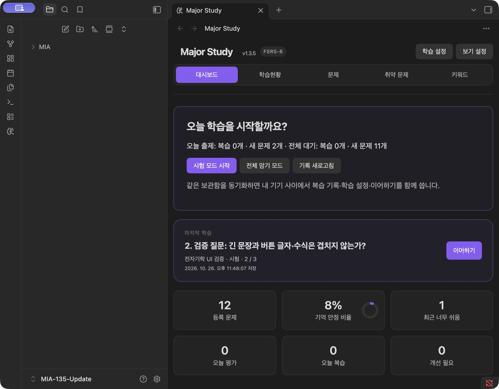
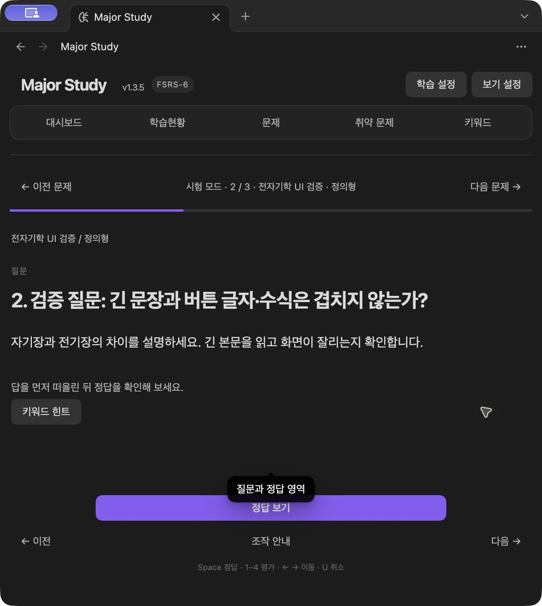
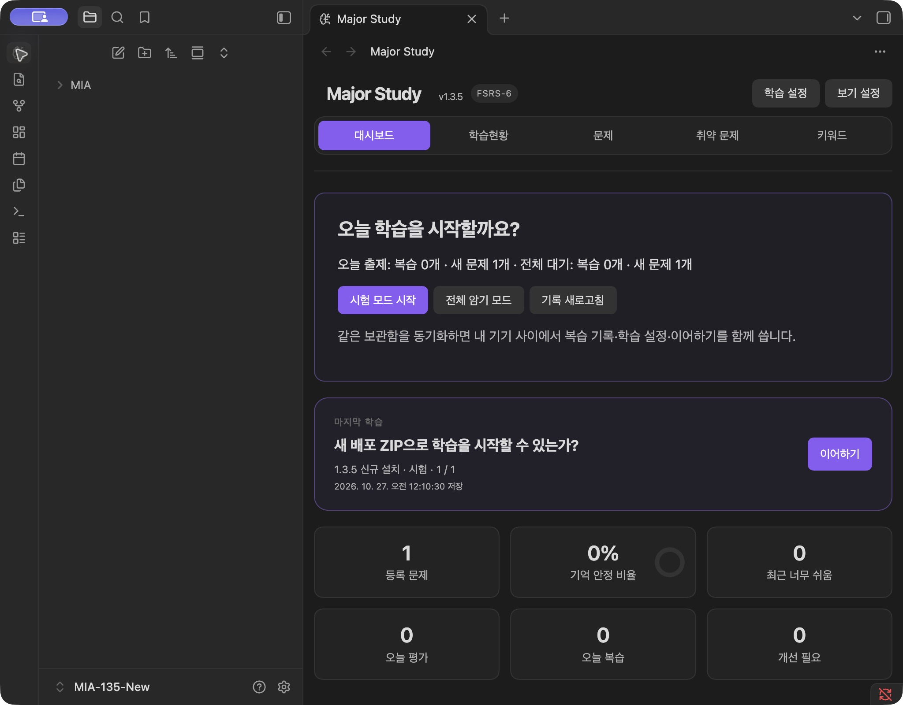
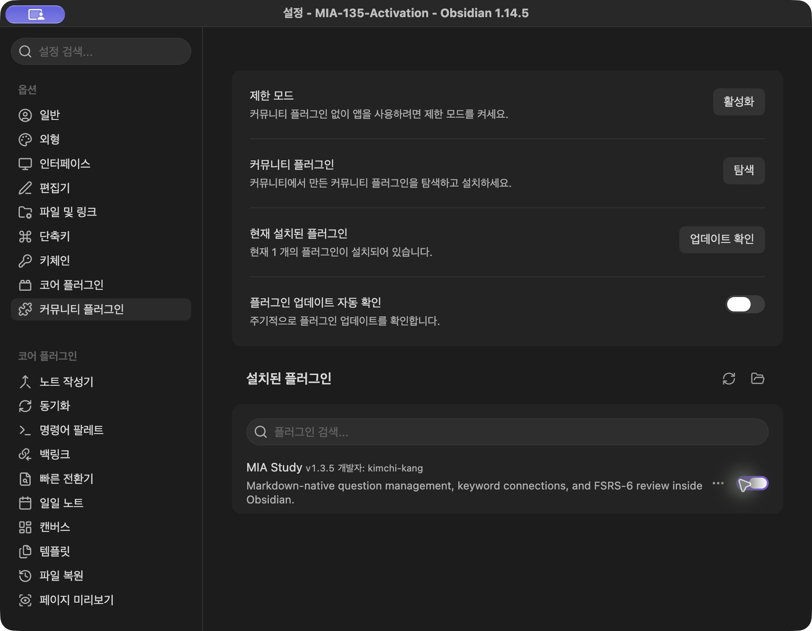
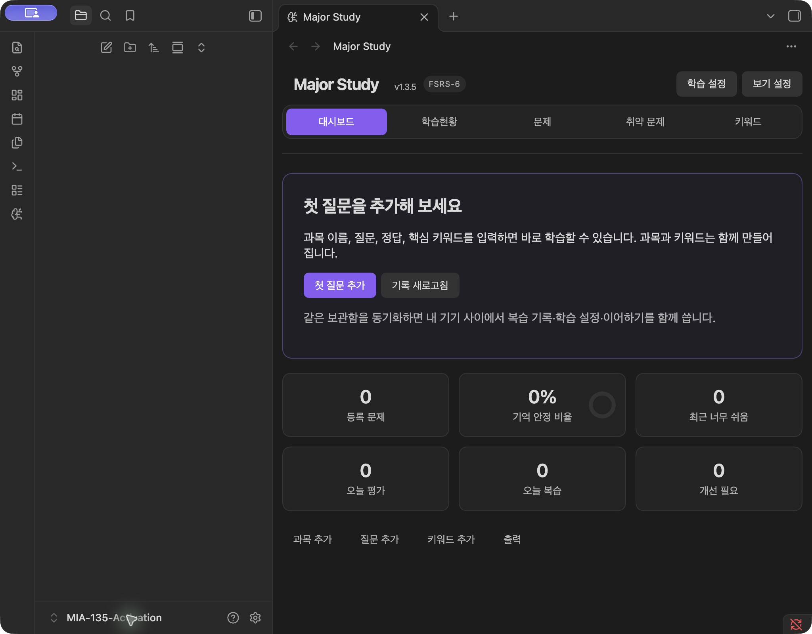

# MIA Study 1.3.5 정식 패키징 검증

2026-10-27. 출시 버전 1.3.5 확정 후 기존 후보 기록을 이어서 검증했다. 원격 푸시·태그·릴리스·스토어 게시를 수행하지 않았다.

## 산출물과 변경 범위

최종 산출물은 저장소의 `artifacts/1.3.5-final/mia-study-1.3.5.zip`이다. 같은 폴더에 `SHA256SUMS`, `BUILD-INFO.json`, `INSTALL.md`, `RELEASE-NOTES.md`, 라이선스와 세 개의 원본 설치 파일을 동봉한다. `artifacts/`는 Git 제외 대상이며 자동 게시되지 않는다.

`package.json`, lockfile 최상위 및 루트 패키지, `manifest.json`을 1.3.5로 갱신하고 `versions.json`에 `1.3.5: 1.8.7`을 추가했다. 기존 버전 매핑은 보존했다. 배포 명령에 명시적 `--release` 옵션을 추가해 manifest와 같은 버전의 릴리스 노트를 읽고 버전 이름의 ZIP을 만든다. 기존 미출시 후보 모드와 덮어쓰기 거부는 유지한다. 빈 문자열 또는 공백뿐인 라이선스 파일도 거부한다.

제품 JS와 CSS는 이전에 직접 검증한 후보와 바이트까지 같으며, 이번 변경은 버전·패키징·문서와 그 검사에 한정한다. 검증 당시 이전 후보 `mia-study-unreleased-32a35cf32e40.zip`의 SHA-256 `49f4a507728d29cc1c3aab9b46b4a83b58019fc77c63c4efc5f791bf112730df`도 그대로 유지되었다. [이전 검증 기록](../unreleased-install/README.md)은 역사적 기록으로 보존한다.

원격 공개 상태를 나타내는 `docs/candidate.json` 및 공개 다운로드 링크의 1.3.4는 아직 게시된 릴리스를 가리킨다. 1.3.5가 이미 공개된 것처럼 바꾸지 않았다. 실제 게시 시 공개 메타데이터와 다운로드 페이지의 갱신이 필요하다.

2026-10-27 정리 후 최종 `artifacts/1.3.5-final/`만 현재 배포 산출물로 보존한다. 중간 1.3.5 패키지와 후보 ZIP, 이 검증의 닫힌 합성 보관함은 삭제했고, 화면·수치·이전 합성 데이터는 유지한다. [정리 내역](../../../CLEANUP.md)

## 실제 Obsidian 설치·업데이트

macOS 27.0.1, 실제 Obsidian 1.14.5. 사용자 보관함과 분리된 테스트 보관함 3개를 사용했다. 세 보관함에 설치한 파일 모두 최종 ZIP의 내용과 완전히 같다. 화면 자동 조작 연결 장애가 있었으며 복구 후 아래 동작을 수행했다. 모바일 에뮬레이션을 실기기로 계산하지 않았다.

| 환경·시나리오 | 결과 |
| --- | --- |
| `MIA-135-New`: 빈 보관함에 ZIP 설치 → 신뢰 안내 → 활성화 → 리본 진입 | 설정과 MIA 제목에 v1.3.5 표시, 첫 질문 안내 |
| 같은 보관함에서 과목·질문·정답·핵심 키워드 입력 → 저장 | 질문 1개·과목·키워드 파일 생성 |
| 시험 시작 → Space로 정답 표시 | 직접 입력한 답안 표시, 평가 버튼 표시 |
| 명시적 재활성화 후 보관함 닫기 → 재열기 | 활성화 유지, v1.3.5 자동 로드, 질문 1개와 1/1번째 이어하기 유지 |
| `MIA-135-Activation`: 별도의 빈 보관함 최초 설치·활성화 → 활성화 파일 확인 → 닫기 → 재열기 | 최초 활성화 유지, v1.3.5 자동 로드, 빈 화면 정상 |
| `MIA-135-Update`: 실제 정식 1.3.4 → 세 설치 파일만 1.3.5로 교체 → 재열기 | v1.3.4에서 v1.3.5로 변경, 12문제·기존 복습·이어하기 유지 |
| 업데이트 후 학습 설정 열기 → 취소 | 하루 새 문제 7, 최대 복습 3 유지 |
| 업데이트 후 이어하기 → Space → 4 평가 | 2/3번째 문제 복원, 새 평가 저장, 3/3번째 문제 이동 |

업데이트 출발점은 앞선 검증에서 실제 1.3.4 UI로 설정·복습 1건·이어하기를 만든 합성 데이터의 보존 사본이다. 실제 1.3.4 배포 파일을 설치해 v1.3.4와 상태를 다시 확인한 뒤 보관함 창을 닫고 교체했다. 노트 8개·`data.json`·`ui-state.json`·활성화 목록 등 11개 파일이 교체 직후와 1.3.5 로드 직후 모두 이전과 바이트 단위로 같았다. 이후 새 평가 1건을 저장해도 원래 평가와 설정은 동일했다. [검증 수치](verification.json)

### 추가 관찰: 최초 활성화 유지

첫 번째 새 보관함을 처음 재열었을 때 활성화 목록이 `[]`인 상태를 한 번 관찰했다. 당시 화면 자동 조작 오류·창 변경도 발생했으나 원인 관계는 확정하지 않았다. 이를 제품 오류나 사용자 조작으로 단정하지 않는다. 명시적으로 다시 활성화하고 목록 저장을 확인한 후 닫기·재열기는 정상이다. 같은 ZIP을 설치한 두 번째 독립 빈 보관함에서는 최초 활성화·닫기·재열기 모두 정상이며 비활성화를 재현하지 못했다.

설치·업데이트 자체와 데이터 보존을 막는 재현 가능한 결함은 확인되지 않았다. 다만 이 관찰을 해결된 오류로 처리하지 않았으며, 공개 전 독립 수동 신규 설치에서 최초 활성화 유지 여부를 한 번 더 확인하는 것을 권장한다. 설치 안내에는 재실행 후 스위치와 시작 상태 확인 방법을 포함했다.

## 이번에 다시 실행한 검사

- `npm run package:release -- --release --out-dir artifacts/1.3.5-final`: strict 타입 검사·프로덕션 빌드·정식 패키징 통과.
- `npm test -- tests/package-release.test.js tests/local-install.test.ts tests/startup-bundle.test.js tests/installer-safety.test.js tests/plugin-lifetime.test.js`: **5개 파일 / 58개 통과**. 정식 파일명·릴리스 노트 선택·후보 보존·기존 출력 거부·공백 고지 거부를 포함한다.
- ZIP CRC·정확한 세 필수 파일·manifest 1.3.5·최소 1.8.7·라이선스/외부 고지 전문 포함·모든 체크섬을 검사했다. 이전 후보 및 1.3.5 첫 패키지와 최종 ZIP이 바이트 단위로 같다.
- 소스맵·개발자 홈 경로·고신뢰 비밀키 패턴이 없고, ZIP에 소스·테스트·사용자 데이터·node_modules가 없다. 모든 가능한 비밀정보를 검출한다는 보증은 아니다.
- `git diff --check` 통과. 별도 lint 명령은 없다. 앞선 전체 기능·반응형·저장 복구 검사 결과는 이어받았으며 관련 변경이 없어 전부 반복하지 않았다.

ZIP SHA-256: `c92d1d8424ee9b8150f256b307ccc0d68abc5e91194959c17fa8c5f08fc1eb48`.

## 남은 범위와 공개 전 작업

- 모바일·Windows·Linux 실기기, 최소 지원 앱 1.8.7, BRAT 원격 다운로드/자동 업데이트는 이번에도 미검증이다. 모바일 시작 번들 자동 검사는 모의 환경이며 실기기 검증이 아니다.
- Obsidian 전체 프로세스 종료는 다른 보관함에 영향을 주므로 수행하지 않았다. 대상 테스트 보관함의 모든 창을 닫고 재열어 플러그인을 다시 로드했다.
- 범용 동기화 모드의 구버전 → 새 버전 실제 업데이트, 클라우드 전송 중단, 더 오래된 모든 버전/다운그레이드를 추가 검증하지 않았다. 데이터 형식 변경은 없다.
- [INSTALL.md](../../../INSTALL.md)에 모바일 수동 설치·숨김 폴더 접근 불가 시 선택지와 6개 항목의 짧은 점검 목록이 있다.
- 버전 미확정 문제는 해소됐다. 패키지는 로컬 설치와 검증에 사용할 수 있다. 위 최초 활성화 관찰의 독립 수동 재확인과 미검증 환경 수용 여부를 확인한 뒤, 별도 공개 승인 시에만 원격 파일·태그·릴리스·다운로드 페이지를 게시한다.
