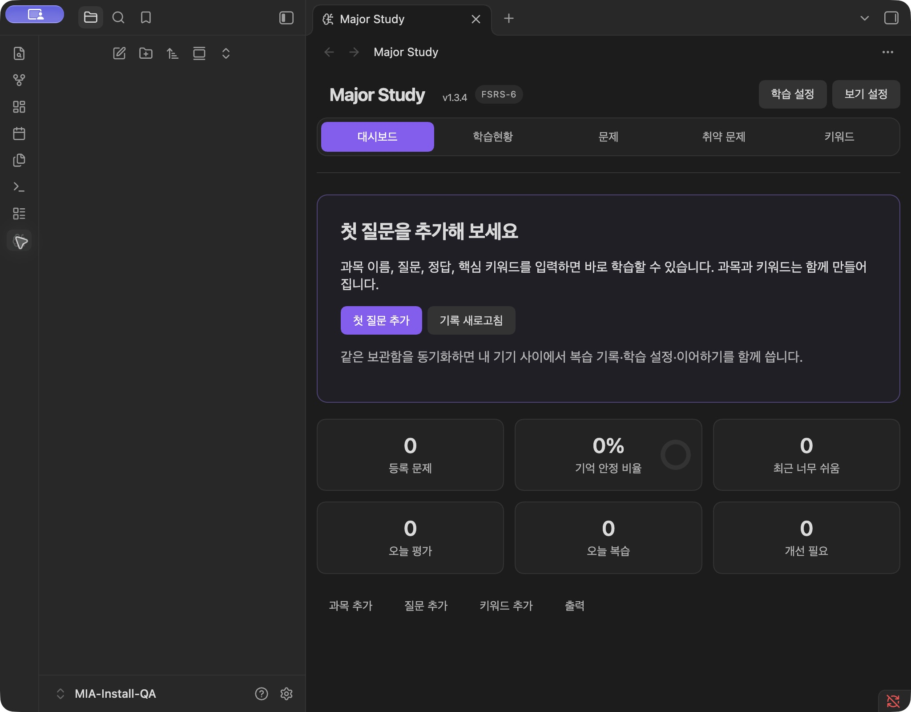
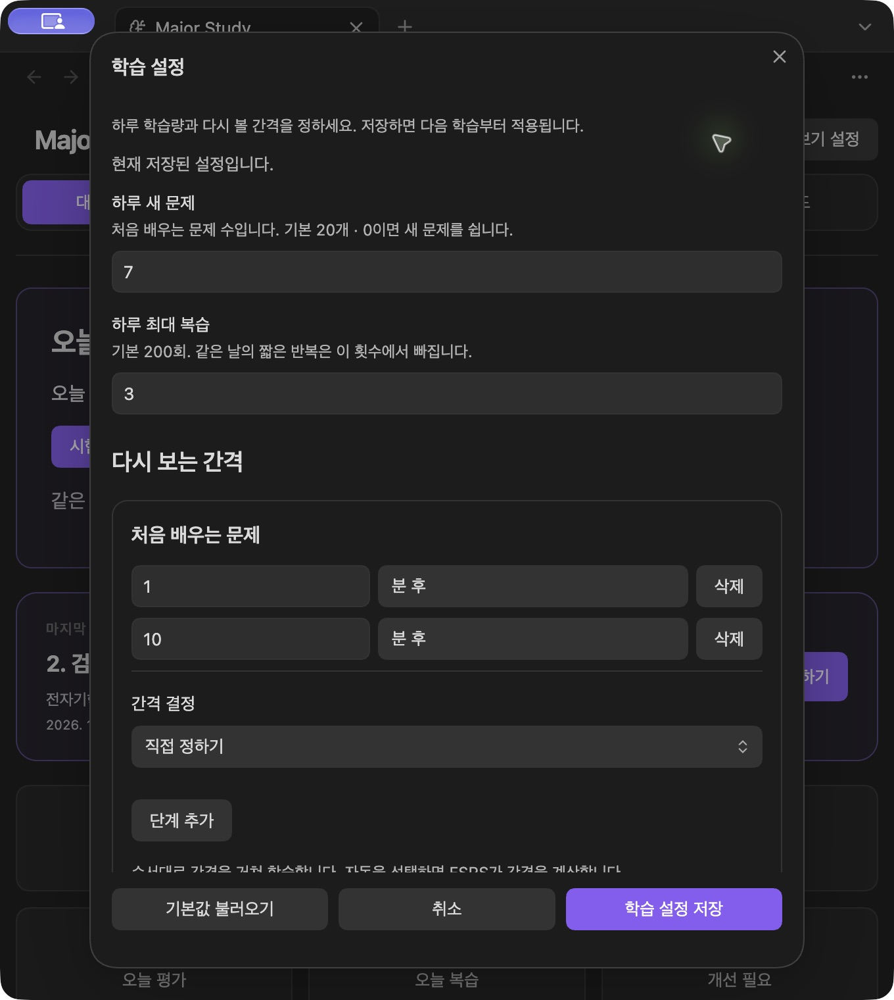
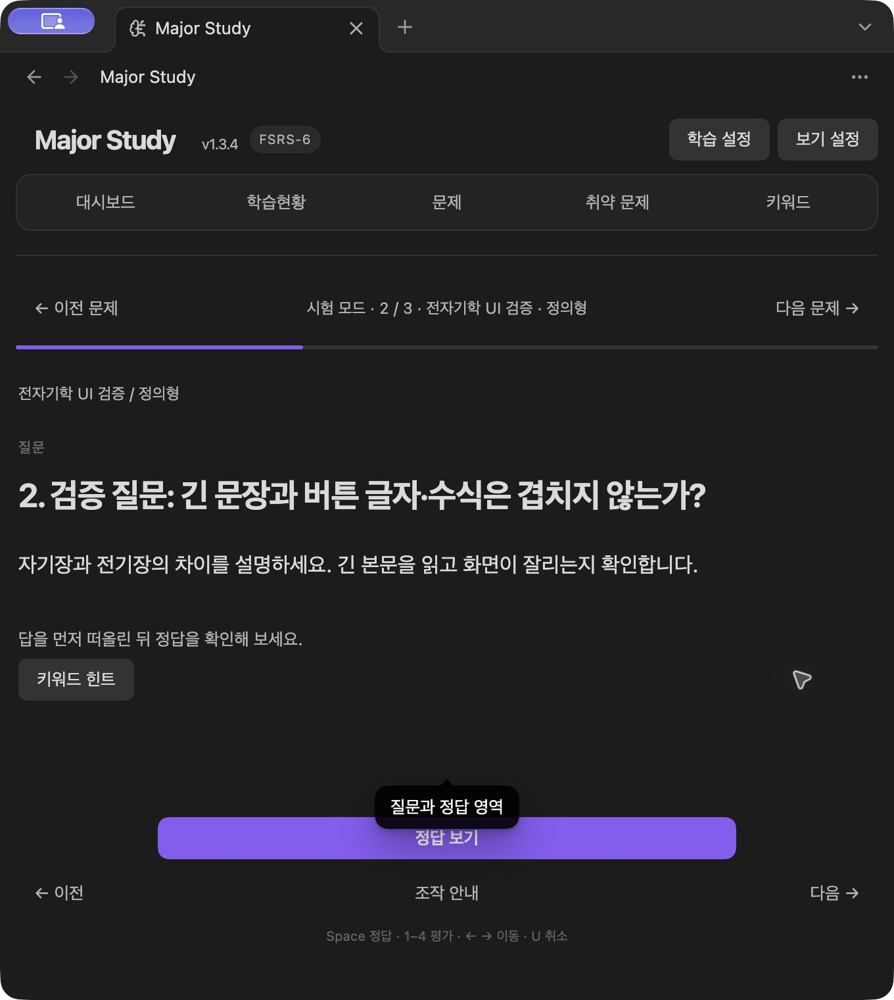

# 미출시 후보 설치·업데이트 검증

이 문서는 2026-10-26 후보의 보존 기록입니다. 이후 1.3.5 버전이 확정되었으며 최신 결과는 [1.3.5 검증 기록](../1.3.5/README.md)을 확인하세요.

검증일: 2026-10-26. 기준 소스 `c03ca35` 이후 배포 준비 보완. 공개 작업은 수행하지 않았다. 내장 버전은 아직 1.3.4이며 다음 정식 버전으로 1.3.5를 권장한다. 기존 1.3.4와 같은 번호로 이 후보를 정식 게시하면 자동 업데이트·버전 식별이 불명확하므로, **출시 버전 확정과 메타데이터 갱신 후 재패키징이 남아 있다.**

## 환경과 직접 조작

macOS 27.0.1 / 실제 Obsidian 1.14.5. 기존 사용자 보관함을 수정하지 않고 별도 `MIA-Install-QA`, `MIA-Update-QA` 보관함을 만들었다. 첫 설치 보관함은 빈 상태에서 시작했고 업데이트 보관함은 합성 문제 12개·키워드 2개를 사용했다. 산출 ZIP의 세 파일을 추출해 설치했으며 설치한 파일과 원본 패키지의 바이트가 일치했다.

| 경로 | 실제 결과 |
| --- | --- |
| 빈 보관함에 설치 → 신뢰 안내 → 커뮤니티 플러그인 활성화 → 리본 열기 | 플러그인 인식, 첫 질문 안내 표시 |
| 첫 질문 추가 → 과목·질문·정답·핵심 키워드 → 저장 | 과목과 질문 생성, 등록 문제 1개 표시, Markdown 저장 확인 |
| 설정에서 비활성화 → 재활성화 → 리본 열기 | 질문 1개 유지, 다시 진입 가능 |
| 실제 이전 1.3.4 → 미출시 후보 교체 → 보관함 재열기 | 설정·기록·이어하기·문제·키워드 보존 |
| 업데이트 후 학습 설정 열기 | 구버전에서 저장한 하루 새 문제 7, 최대 복습 3 유지 |
| 이어하기 → 정답 표시 → 키보드 4 평가 | 2/3번째 문제 복원, 새 평가 저장 후 3/3번째 문제로 이동, 기존 평가 유지 |

이전 파일은 로컬에 보관된 정식 1.3.4 세 파일이며 Git 릴리스 커밋 `02aa734`의 파일과 각각 완전히 일치함을 확인했다. 구버전에서 직접 설정·평가 1건·이어하기를 저장한 뒤 해당 테스트 보관함의 모든 창을 닫고 ZIP 파일 세 개만 교체했다. 교체 직후와 재열기 직후 모두 문제·키워드 노트 8개, `data.json`, `ui-state.json`, 활성화 목록 등 **11개 파일의 SHA-256이 이전과 같았다.** 이후 새 평가 1건을 추가로 저장하고 원래 평가·설정의 유지도 확인했다. 정식 버전 번호가 상승하는 BRAT 업데이트 검증을 대신하는 결과는 아니다.

## 빌드·자동 검사·포함 파일

- Node.js 26.0.0, npm 11.12.1. 설치된 의존성은 `npm ls --depth=0`에서 모두 선언 범위와 일치.
- `npm run package:release -- --out-dir <새 폴더>`: strict 타입 검사와 프로덕션 빌드 통과. ZIP 파일명은 `mia-study-unreleased-32a35cf32e40.zip`이며 배포 세 파일로 계산한 ID는 `32a35cf32e40`이다.
- 관련 자동 검사 **9개 파일 / 173개 통과**: 새 패키징 회귀 검사, 설치 안전성, 로컬 설치, 프로덕션 모바일 시작 번들, 플러그인 수명, 저장 무결성·강제 중단 복구·범용 저장소·검증 저장소. 이미 완료한 전체 기능·반응형 검사는 이번에 반복하지 않았다. 별도 린트 명령은 없다.
- 새 패키징 검사는 ZIP의 정확한 세 파일·원본 일치·체크섬·동일 입력의 동일 ZIP, 버전 불일치 거부, 개발용 소스맵·누락 파일·고지 누락 거부, 기존 출력 폴더 보호를 검증한다.
- 패키징은 `package.json`, lockfile 루트, manifest 버전과 `versions.json`의 최소 앱 버전을 대조한다. 현재 모두 1.3.4 / 최소 1.8.7. 사용자 측 npm 설치는 필요하지 않다.
- ZIP에는 `main.js`, `styles.css`, `manifest.json`만 포함한다. 라이선스와 외부 코드 고지 전문은 main.js에도 들어 있다. 폴더에는 라이선스·안내·릴리스 노트·빌드 정보·체크섬을 별도로 동봉한다.
- allowlist로 소스·테스트·개발 의존성·개인 설정을 제외했다. 프로덕션 번들에 소스맵·개발자 홈 경로·합성 테스트 데이터·고신뢰 비밀키 패턴이 없음을 별도 검사했다. 이는 모든 가능한 비밀정보에 대한 보증을 뜻하지 않는다. 소스의 콘솔 출력은 시작 진단 저장소의 실제 실패 경고 2곳이며 임시 디버그 출력은 없다.

## 데이터 호환성과 복구

직전 정식 릴리스 이후 저장 형식 변경은 없다. 새 변환이나 초기화가 필요하지 않다. 기본 저장소의 실제 업데이트는 위와 같이 확인했다. 범용 동기화 저장소는 관련 자동 검사로 검증했고 실제 구버전 → 후보 업데이트와 기기 간 클라우드 전송은 별도로 실행하지 않았다.

설치 안전성 자동 검사는 각 파일의 쓰기·교체·검증 중 실패/강제 종료 후 같은 빌드 재설치와 사용자 파일 보존을 확인한다. 세 파일 전체의 교체는 원자적 트랜잭션이 아니므로 중단되면 앱을 열기 전에 같은 패키지의 세 파일을 다시 설치해야 한다. 데이터와 활성화 목록을 과거 사본으로 덮어쓰지 않는다. 복구 절차는 [INSTALL.md](../../../INSTALL.md)에 반영했다.

## 확인하지 못한 범위와 판단

- Windows·Linux·iOS·Android 실기기 및 Obsidian 최소 표기 버전 1.8.7에서의 실제 설치·실행. 모바일 시작은 번들 경계 모의 검사로만 확인했다.
- BRAT 원격 다운로드·자동 업데이트, 모바일 파일 앱을 이용한 수동 설치, 실제 동기화 서비스의 전송 중단. 공개 작업 금지 범위와 로컬 환경 제한으로 실행하지 않았다.
- Obsidian 전체 프로세스 종료·다시 실행: 다른 보관함 작업을 건드리지 않기 위해 대상 테스트 보관함의 모든 창을 닫고 다시 열어 플러그인을 새로 로드했다.
- 더 오래된 모든 버전에서의 업데이트·다운그레이드는 확인하지 않았다. 실제 업데이트는 1.3.4 → 현재 후보에 한정한다.

확인한 환경에서 기능·데이터 보존을 막는 문제는 발견하지 않았다. 현재 파일은 설치 검증 가능한 **미출시 후보**다. 정식 공개 전 남은 필수 사항은 출시 버전 승인과 관련 메타데이터·릴리스 노트 확정, 해당 버전으로 재빌드·패키징 및 파일 점검이다. 원격 푸시·태그·릴리스·스토어 업로드는 수행하지 않았다.
